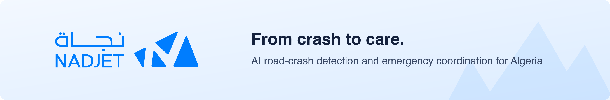

  

  
  
  
  

 

**Nadjet** (نجاة) is an AI road-crash detection and emergency coordination platform for Algeria. It spots crashes on existing road cameras, takes citizen reports by web or SMS where there are no cameras, and coordinates the response: the right unit, the right hospital, and alerts by app and SMS. A trained operator verifies every alert before help is sent.

- [Nadjet](https://github.com/Nadjeet/nadjet) - The platform monorepo: vision workers, AI verification, coordination API, web app for operators, responders, hospitals and citizens, and deployment.

- [Nadjet Docs](https://github.com/Nadjeet/Nadjet-Docs) - Architecture, wiring, API reference, operations and design decisions for the whole platform.

### Resources

- [Documentation](https://github.com/Nadjeet/Nadjet-Docs) - Start here to understand how the platform works
- [Status and limits](https://github.com/Nadjeet/Nadjet-Docs/blob/main/Overview/03-status-and-limits.md) - What is built, and what is still a proof of concept

Repositories are private and open to organisation members.
