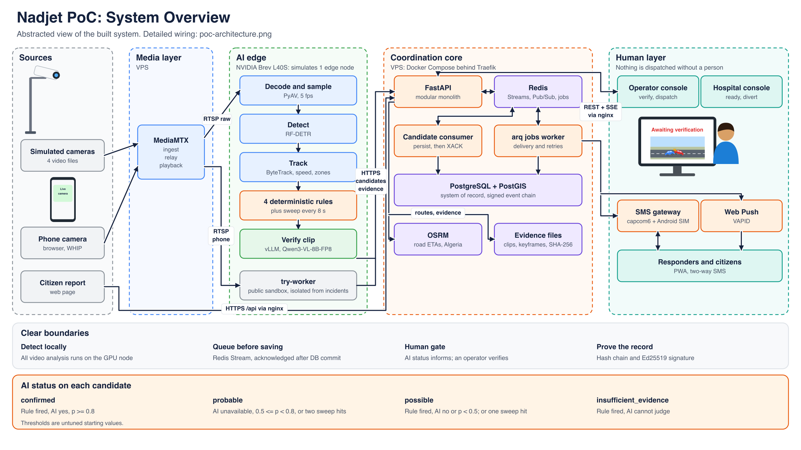
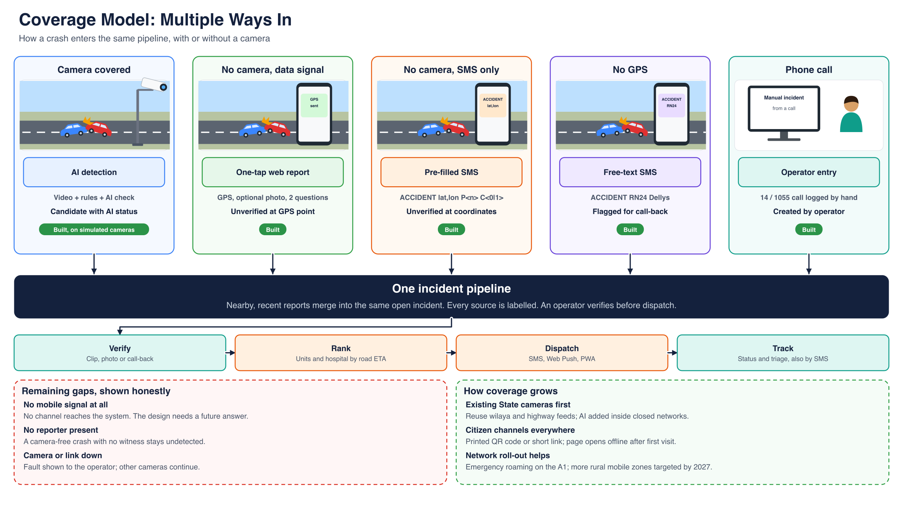

<p align="center">
  
</p>

<h3 align="center">From crash to care: AI detection and coordinated emergency response for Algerian roads</h3>

<p align="center">
  
  
  
  
  
  
</p>

---

## About Nadjet

**Nadjet** (نجاة, *rescue*) connects road-crash detection to the emergency response. It finds crashes on existing road cameras with AI, takes reports from citizens where there are no cameras, and coordinates the response: the right unit, the right hospital, and alerts by app and SMS, even without mobile data.

Detection alone isn't enough. What matters is how fast the right help arrives and how well everyone involved is informed. Nadjet covers the whole chain, and **a trained person verifies every alert before help is sent.**

## How it works

| Step | What happens |
|---|---|
| **1. Detect** | AI watches camera video for collisions, sudden stops, stalled vehicles and people on the road. Citizens report by web or SMS; operators log phone calls. |
| **2. Verify** | A vision-language model reviews a short clip and gives a graded confidence. An operator confirms or rejects it. |
| **3. Dispatch** | Units and hospitals are ranked by road travel time. The operator chooses. |
| **4. Alert** | Units and the hospital are alerted by SMS and Web Push. |
| **5. Follow up** | Responders report status and triage by app or SMS. Hospitals answer Ready or Divert. |

<p align="center">
  
</p>

## Repositories

| Repository | Purpose | Highlights |
|---|---|---|
| [**nadjet**](https://github.com/Nadjeet/nadjet) | The platform monorepo | Vision workers, coordination API, web app, shared contracts, deployment |
| [**Nadjet-Docs**](https://github.com/Nadjeet/Nadjet-Docs) | Platform documentation | Architecture, wiring, API reference, operations, decisions, AI |

Repositories are private. Members of the organisation can open them.

### Inside the platform

```
nadjet/
├── services/api        Coordination API: incidents, dispatch, notifications, auth
├── services/vision     Vision workers and AI client (detection, tracking, rules, verification)
├── services/camsim     Simulated cameras for development and demos
├── packages/shared     Event contracts shared by every service
├── packages/api-client Typed TypeScript client generated from OpenAPI
├── apps/web            Operator, responder, hospital and public surfaces
├── contracts/          Generated OpenAPI, event schemas, SMS grammar
└── deploy/             Local, GPU and server deployment
```

## Architecture at a glance

| Layer | Technology |
|---|---|
| Video | MediaMTX: RTSP, WebRTC and LL-HLS |
| Detection | RF-DETR, ByteTrack, deterministic crash rules |
| AI verification | Qwen3-VL on vLLM, on an NVIDIA GPU |
| Coordination | FastAPI modular monolith, Redis Streams, arq jobs |
| Data | PostgreSQL with PostGIS |
| Routing | Self-hosted OSRM with Algerian road data |
| Field alerts | Two-way SMS gateway, Web Push, offline-capable PWA |
| Web | React 19, Vite, Tailwind, offline maps |

## Coverage beyond cameras

Cameras cover only part of the road network, so every channel feeds the same pipeline: AI detection, a one-tap web report, a pre-filled GPS SMS that works without mobile data, a free-text SMS, and operator entry from phone calls.

<p align="center">
  
</p>

## Engineering principles

- **Human in the loop.** AI raises alerts; a person decides. No automation path skips verification.
- **Honest AI.** Every AI value shows its source. When the AI is down, the system says so instead of guessing.
- **Traceable records.** Incident events form a signed hash chain, and evidence files carry SHA-256 hashes.
- **Contracts first.** The API schema, event schemas and TypeScript client are generated, and CI rejects drift.
- **Built for weak networks.** SMS is a full channel, and field actions queue offline.
- **Quality gates.** Strict typing, linting, unit and integration tests, and integrity checks on every change.

## Status

Nadjet is a **proof of concept**. The full chain runs on simulated cameras built from video files, with AI on a rented NVIDIA GPU. Performance results haven't been recorded yet.

A national design is proposed in the documentation: local AI servers in each wilaya, a closed State network, and two data centres in Algeria. It would need State partners and legal approvals before deployment.

## Team

Built by [Adel2411](https://github.com/Adel2411), [BenAbdou1001](https://github.com/BenAbdou1001) and [imadEddineBMZ](https://github.com/imadEddineBMZ).

<p align="center"><sub>Nadjet · AI road-crash detection and emergency coordination for Algeria</sub></p>
